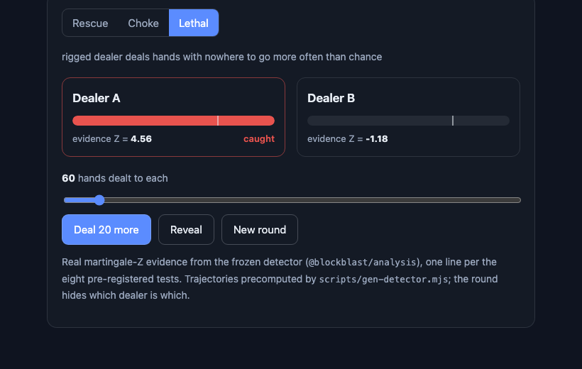

# Block Blast Analysis

> **You aren't playing Block Blast. Block Blast is playing you.**

Block Blast is one of the most-downloaded mobile games in the world. Lots of people suspect the
three pieces you get each turn are not a fair shuffle. This project checks that, carefully.

We read the game's own code, rebuilt its rules and its dealer in TypeScript, wrote a statistical
test that can tell a rigged dealer from a fair one, proved the test works on dealers we built
ourselves, and wrote an interactive essay that walks a normal person through all of it.

```
   the board                 your three pieces
   . . . . . . . .
   . . . . . . . .           # #     # # #     #
   # # # # # # # .           # #             #
   # # # # # # # .                           #
   . . . . . . . .
   . . . . . . . .      one obvious gap, and none of the
   . . . . . . . .      three pieces fits it. bad luck?
```

(`#` is a filled cell, `.` is empty, the same notation the engine uses.) That moment, the piece
that never comes, is where this starts.

## What we found

- The piece generator is **not** in the JavaScript. It is a native library, `libtask.so`, that
  shipped with its function names intact. One of them is literally called `func_death_blcok`
  (deal a death block), with a whole family of "hard problem" and "lethal puzzle" routines around it.
- From early in a game, the script asks for a **lethal hand** (one that cannot be placed in any
  order) on almost every deal. It can only comply when the board is tight, which on the boards you
  actually see mid-game is most of the time.
- The dealer is not simply mean. In every version we can run, it is **generous early** (it keeps the
  worst shapes out of your opening) and saves the squeeze for near your personal best. Being
  generous is how it keeps you playing.
- Our detector tells a rigged dealer from a fair one and never cries wolf on a fair one. It is
  **frozen** (tagged `prereg-v1`) before it was ever pointed at real data.

What we have **not** done yet: measure these effects on a large sample of real games. The capture
pipeline works but needs more build-out, so the real-world effect sizes are still open. See
[`docs/findings/`](docs/findings/) for exactly what is confirmed and what is not.

## The essay

The centerpiece is an interactive essay (`apps/essay`) that builds the argument one playable demo
at a time: a fair board you can play, the shape of fair play over thousands of games, and a detector
you watch catch a rigged dealer in real time.



```bash
pnpm install
pnpm --filter @blockblast/essay dev      # open the printed localhost URL
```

## How it's organized

A pnpm + TypeScript monorepo. The engine runs in Node (for mass simulation) and in the browser
(for the essay demos), from the same code.

```
docs/research/     the pre-registered plan, the hypotheses, the literature (sourced)
docs/findings/     what reading the app actually turned up, and the detector's validation
packages/engine    the game rules: bitboard, shapes, scoring, the solvability oracle, the agents
packages/generators  the "dealer zoo": fair, weighted, bag, rescue, kill, lethal, and a model of the real one
packages/analysis  the detector: eight statistical tests, Holm correction, synthetic validation
packages/capture   drives the real game on an Android emulator (adb, Frida, a board reader)
apps/sim-cli       run thousands of games; run the detector; run power curves
apps/essay         the interactive essay (Vite + React)
```

How the pieces connect:

```
  the APK
    │   read libtask.so with Ghidra (no key needed)
    ▼
  rebuild the rules and the dealer in TypeScript  (engine + the dealer zoo)
    │
    ▼
  a detector that tells rigged from fair          (8 tests, frozen before real data)
    │
    ▼
  an interactive essay that shows it to a reader  (apps/essay)
```

## The method, briefly

The whole point is that you could redo this. The statistical method is written down in
[`docs/research/06-methods.md`](docs/research/06-methods.md), committed and tagged (`prereg-v1`)
**before** it touched any real data, and checked on dealers whose behavior we already know: it
flags every rigged one and never a fair one. Every figure in the essay rebuilds from a script named
in its caption.

## Run it

```bash
pnpm install
pnpm -r build          # build every package
pnpm -r test           # 196 tests
pnpm --filter @blockblast/essay dev                       # the essay
node apps/sim-cli/dist/cli.js validate                    # the synthetic validation, in your terminal
node apps/sim-cli/dist/cli.js power --generator lethal --target H4   # a power curve
```

## What we don't publish

Methods, aggregate numbers, and the strategy names are fair game. The decryption key, the decrypted
scripts, the APK, and anything that would help someone repackage the game are not, and never get
committed here.

## Credits

This replicates and quantifies the October 2026 teardown by Ayo Omolewa ("Ayoships"), which first
opened the app and named the lethal algorithm. We treated its claims as things to test. It also
builds on open-source Block Blast clones, solvers and board-readers, and on thirty years of
dynamic-difficulty research (see [`docs/research/04-dda-and-psychology.md`](docs/research/04-dda-and-psychology.md)).
